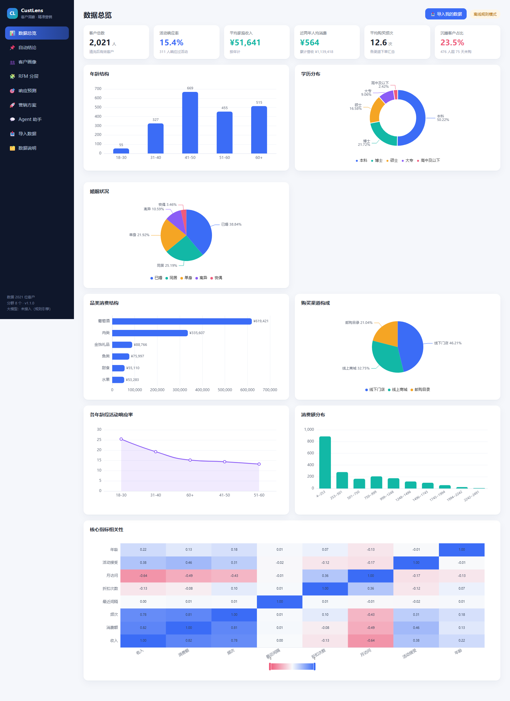
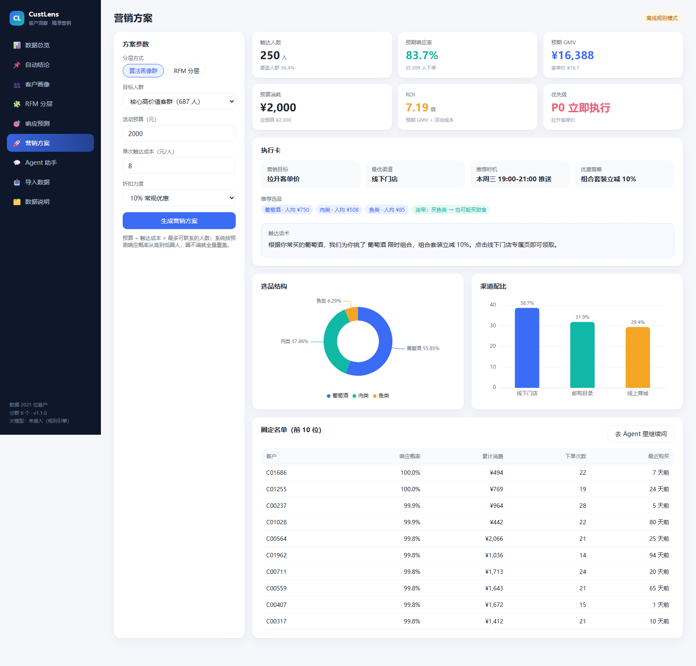
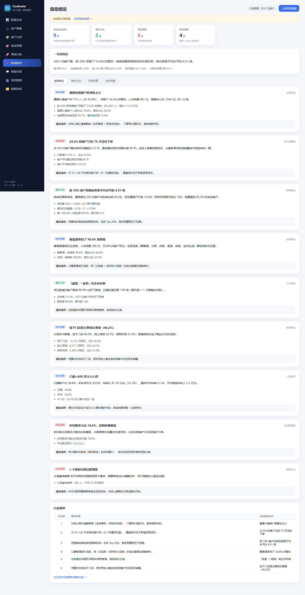

# CustLens 客户洞察与精准营销平台

面向客户数据分析场景的全栈应用：接入一份客户表或订单明细，完成客户画像、分层、活动响应预测与营销方案生成。

主要面向三类使用者：运营与市场人员（不写代码，上传表格即得画像与投放名单）、数据工程人员（通过 REST 接口把分析能力接入自有系统）、以及需要评估系统实现的人（本地或容器一键启动，指标与算法均可复现）。

[](https://github.com/TheLiYY/customer-insight-agent/actions/workflows/ci.yml)
[](LICENSE)
[](https://www.python.org/)
[](https://nodejs.org/)
[](deploy/DOCKER.md)



## 背景

客户数据的分析流程通常卡在两步：字段口径不统一（客户编号叫「会员卡号」、金额带 `￥`、只有日期没有天数），以及分析结果无法直接落到动作上（分层出来了，但不知道先联系谁、推什么、预算怎么分）。

本项目的处理方式是：

1. **数据接入层**自动识别列名并校验内容，把任意客户表规整成统一字段，并按数据实际具备的字段生成能力开关；
2. **分析层**基于统一字段完成分群、分层、响应预测与关联分析；
3. **应用层**把指标翻译成结论与可执行方案，并按能力开关决定展示哪些页面与指标。

## 功能

| 模块 | 输出 | 实现 |
| --- | --- | --- |
| 数据总览 | 客户规模、结构、品类与渠道分布、相关性矩阵 | pandas 聚合与分箱 |
| 客户画像 | 4 类算法客群、人群构成、偏好品类与渠道、标签 | K-Means + 轮廓系数 + 命名规则 |
| 客户分层 | 8 类 RFM 客群、分层矩阵、各层运营策略 | R/F/M 分位打分 |
| 响应预测 | AUC、精确率 / 召回率、混淆矩阵、十分位 Lift、Top-N 名单 | 逻辑回归（类别加权）+ 阈值搜索 |
| 营销方案 | 触达人数、选品、渠道、时机、话术、预期 GMV 与 ROI | 概率排序圈人 + 偏好选品 + 关联规则 |
| 自动结论 | 带证据数字与建议动作的业务结论 | 规则引擎 `core/insights.py` |
| 智能问答 | 中文提问，调用分析工具并渲染图表与表格 | Function Calling，未配置模型时走规则兜底 |
| 我的数据 | 上传 Excel / CSV，先试读字段映射，再应用 | 数据契约层 `core/schema.py` |
| 数据说明 | 字段字典、自动映射明细、能力开关、处理口径 | 元数据自描述 |

## 界面

<table>
  <tr>
    <td width="50%"><br>客户画像：客群、人群构成、偏好品类与渠道</td>
    <td width="50%"><br>响应预测：收益曲线、驱动因素、Top-N 名单</td>
  </tr>
  <tr>
    <td><br>营销方案：圈人、选品、渠道、话术与 ROI</td>
    <td><br>自动结论：指标到结论到动作</td>
  </tr>
</table>

## 快速开始

### Docker

```bash
docker compose up -d --build
# 访问 http://localhost:8080
```

镜像构建阶段会重新生成数据，保证代码与数据版本一致。离线安装包与换机迁移见 [deploy/DOCKER.md](deploy/DOCKER.md)。

### 本地运行

```bash
python -m venv .venv
.venv/Scripts/activate                 # macOS / Linux: source .venv/bin/activate
pip install -r backend/requirements.txt
python scripts/prepare_data.py
python backend/run.py                  # 接口文档 http://127.0.0.1:8000/docs

cd frontend && npm install && npm run build   # 产物 frontend/dist，由 Nginx 托管
```

Windows 环境可用脚本启动与停止（后端 8000、Nginx 8080）：

```powershell
powershell -ExecutionPolicy Bypass -File scripts/dev-start.ps1
powershell -ExecutionPolicy Bypass -File scripts/dev-stop.ps1
```

### 云服务器

```bash
curl -fsSL https://raw.githubusercontent.com/TheLiYY/customer-insight-agent/main/deploy/vps-install.sh | sudo bash
```

脚本安装 Docker、拉取仓库、构建并启动容器，默认宿主机端口 8080（需在安全组放行）。

## 数据接入

三种入口：

- **页面**：「我的数据」页上传，先试读字段映射结果，确认后应用；页内可下载数据模板（客户级宽表 / 订单明细两种写法）。
- **命令行**：`python scripts/prepare_data.py --file "D:/data/客户名单.xlsx" --sheet "客户表"`
- **接口**：`POST /api/import/inspect` → `POST /api/import/apply`，字段说明见 [docs/API.md](docs/API.md)

支持的数据形态：

- 中文或英文列名，主键可命名为 `会员卡号`、`客户编号`、`CustomerID` 等；
- 客户级宽表，或一行一笔订单的明细表（自动按客户聚合消费额、频次与最近购买间隔，文字型商品类目与来源渠道透视成指标列）；
- 只有日期没有天数（`最近消费时间`、`入会日期` 自动换算为间隔天数）；
- 金额含货币符号、千分位或 `万` 单位；
- 多工作表、分号或制表符分隔、`yes/no` 与 `是/否` 标签。

字段缺失时按能力降级：没有响应标签就不展示响应预测页与相关指标列，没有收入字段就不展示收入类图表。扩展字段别名见 [docs/DATA.md](docs/DATA.md)。

## 内置数据的分析结果

以下数值来自仓库内置数据的实际运行结果，可通过 `scripts/export_report.py` 复现：

| 指标 | 结果 |
| --- | --- |
| 客户数 / 历史营收 | 2,021 人 / ¥1,139,418 |
| 活动基线响应率 | 15.39%（311 人响应） |
| 营收集中度 | 前 20% 客户贡献 53.6% 营收 |
| 响应模型 | AUC 0.883；阈值 0.78 下准确率 89.1%、精确率 69.0%、召回率 52.7%、F1 0.598 |
| 排序收益 | 按概率排序，前 10% 人群响应率为平均水平的 4.51 倍 |
| 客群结构 | 核心高价值 687 · 潜力成长 508 · 长尾基础 465（沉默预警）· 稳定贡献 361 |
| 品类关联 | 甜食 → 鱼类：支持度 73.1%、置信度 89.9%、提升度 1.09 |
| 风险指标 | 23.5% 客户超 75 天未下单；折扣购买占比 18.5%；投诉率 0.94% |
| 示例方案 | 预算 ¥2,000 → 触达 250 人、预期 GMV ¥16,388、ROI 7.19 |

两点说明：关联规则的提升度仅 1.09，原因是各品类渗透率普遍超过 90%，交叉购买本身即普遍存在，因此系统给出的建议是组合套餐而非精准交叉推荐；ROI 为估算值，客单价以该人群历史人均消费代替，实际投放后应回填真实转化再校准。

## 算法与实现

| 模块 | 方法 | 选择理由 |
| --- | --- | --- |
| RFM 分层 | R/F/M 分位打分（1–5），组合为 8 类客群 | 不依赖建模，业务可直接理解与执行 |
| 客户分群 | `StandardScaler` + `KMeans(n_init=10)`，轮廓系数与肘部法选 k | scikit-learn 标准实现；k=4 为紧致度与可解释性的折中 |
| 响应预测 | `LogisticRegression(class_weight="balanced")`，`precision_recall_curve` 选阈值 | 正样本占 15%，类别加权并以 F1 选阈值优于默认 0.5 |
| 关联规则 | `mlxtend.apriori` + `association_rules` | 指标口径（支持度 / 置信度 / 提升度）标准化 |
| 自动结论 | 指标与阈值比较，生成「结论 + 证据 + 动作」 | 降低结果使用门槛 |
| 数据契约 | 列名规范化 → 别名打分 → 内容校验 → 能力开关 | 更换数据源无需改代码 |

算法均使用 scikit-learn 与 mlxtend 的既有实现；自行编写的部分集中在业务规则，如客群命名、结论生成与方案编排。

## 技术栈与目录结构

后端 FastAPI + pandas / numpy / scikit-learn 1.9 / mlxtend 0.25；前端 React 18 + Vite 5 + ECharts 5，前后端分离，前端为静态产物由 Nginx 托管；部署提供 Docker Compose 双镜像与单容器两种形式。

```
customer-insight-agent/
├── backend/
│   ├── app/
│   │   ├── main.py                # FastAPI 入口（纯 API 服务）
│   │   ├── api/routes.py          # 分析接口
│   │   ├── api/imports.py         # 上传接口：试读与应用两阶段
│   │   ├── agent/                 # 智能问答：工具、编排、接口
│   │   └── core/
│   │       ├── schema.py          # 数据契约层：任意客户表 → 标准字段
│   │       ├── dataset.py         # 数据注册中心与能力开关
│   │       ├── rfm.py             # RFM 八分层
│   │       ├── clustering.py      # K-Means、轮廓系数、客群命名
│   │       ├── persona.py         # 客群画像
│   │       ├── propensity.py      # 逻辑回归、阈值搜索、Lift
│   │       ├── association.py     # Apriori 关联规则
│   │       ├── insights.py        # 自动结论引擎
│   │       ├── campaign.py        # 营销方案生成
│   │       ├── overview.py        # 总览指标
│   │       └── store.py           # 结果缓存
│   ├── data/                      # 原始数据、清洗结果、Excel 报告
│   └── tests/                     # 接口冒烟测试与数据契约测试
├── frontend/                      # React + Vite + ECharts
├── deploy/                        # Nginx、Docker 与部署文档
├── docs/                          # 文档与界面截图
└── scripts/                       # 数据准备、报告导出、启动脚本
```

## 测试与持续集成

```bash
python backend/tests/smoke_test.py     # 21 项接口冒烟测试
python backend/tests/test_contract.py  # 52 项数据契约测试（离线构造数据）
```

GitHub Actions 在 Python 3.11 / 3.12 / 3.13 三个版本矩阵上执行上述测试、导出 Excel 与 OpenAPI、构建前端，并对 Docker 镜像做构建与健康检查。

## 部署

| 场景 | 方式 | 文档 |
| --- | --- | --- |
| 本地演示、换机 | Docker Compose（api + web） | [deploy/DOCKER.md](deploy/DOCKER.md) |
| 云服务器长期运行 | 一键脚本 + 容器 | [deploy/DEPLOY_ONLINE.md](deploy/DEPLOY_ONLINE.md) |

## 文档

| 文档 | 内容 |
| --- | --- |
| [docs/DATA.md](docs/DATA.md) | 更换数据源、字段别名扩展、能力降级规则 |
| [docs/CHART_GUIDE.md](docs/CHART_GUIDE.md) | 各页图表的读法与结论口径 |
| [docs/GLOSSARY.md](docs/GLOSSARY.md) | RFM、轮廓系数、AUC、Lift、Apriori 等术语说明 |
| [docs/CODE_TOUR.md](docs/CODE_TOUR.md) | 代码结构与请求处理链路 |
| [docs/API.md](docs/API.md) | 接口字段级说明 |
| [docs/PROJECT_GUIDE.md](docs/PROJECT_GUIDE.md) | 项目讲解与演示脚本 |

接口定义可导出后导入 Apifox 或 Postman：`python scripts/export_openapi.py`，产物为 `docs/openapi.json` 与 `docs/API.postman.json`。

## 已知限制

- 计算结果全部在内存中完成，适合数万行量级；单文件上传上限 64 MB，更大规模建议先按客户汇总。
- 智能问答的在线模式需要 OpenAI 兼容接口；未配置时使用规则引擎，回答基于同一套分析工具，但意图识别覆盖范围较窄。
- 系统无账号体系与多租户隔离，上传文件保存在本机 `backend/data/uploads/`（已在 `.gitignore` 中排除）。
- ROI 与预期 GMV 为基于历史人均消费的估算，需以实际投放结果校准。

## 许可与数据来源

代码以 MIT License 发布，见 [LICENSE](LICENSE)。

内置示例数据来自 Kaggle 公开数据集 [Customer Personality Analysis](https://www.kaggle.com/datasets/imakash3011/customer-personality-analysis)，已脱敏，仅用于演示与测试。
