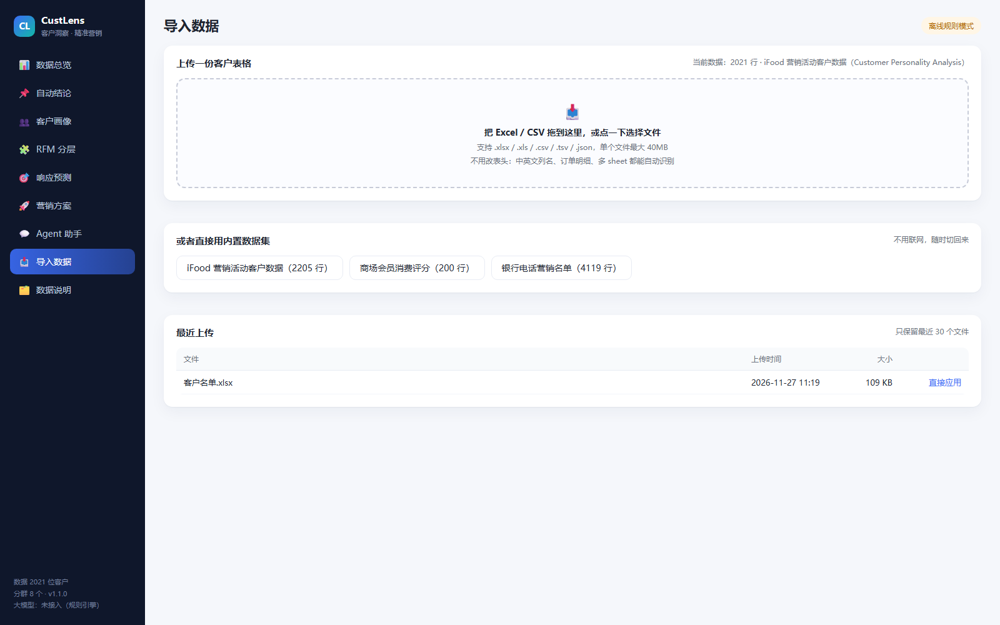
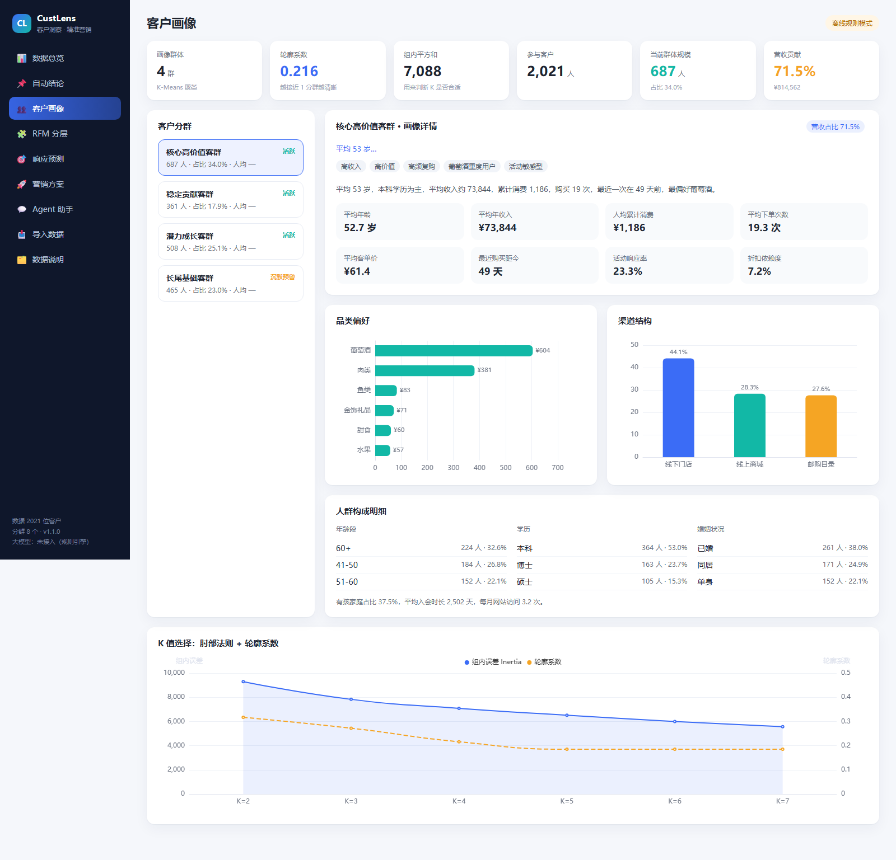
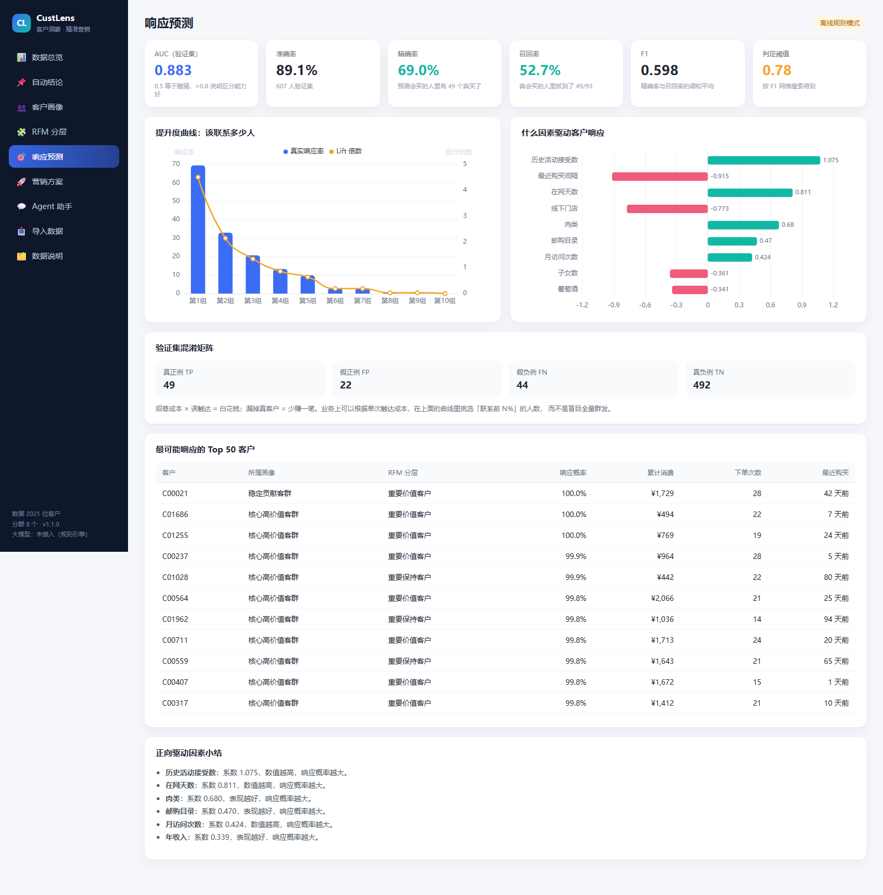
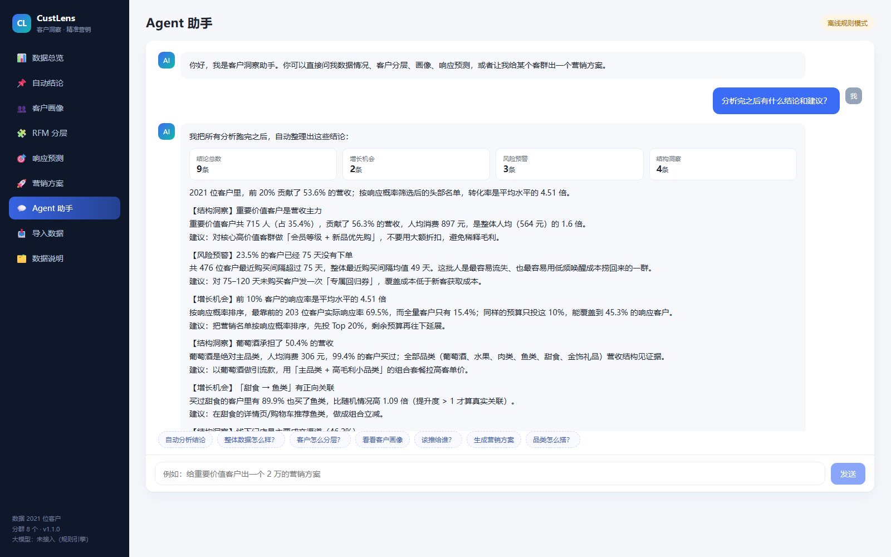
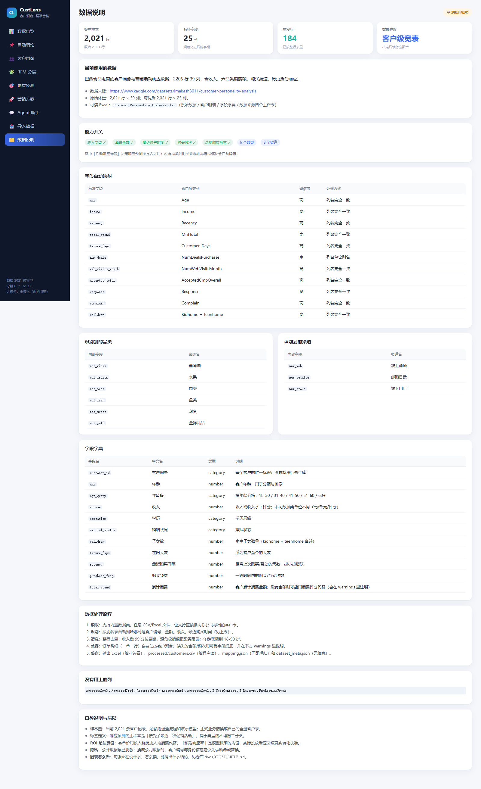

# CustLens · 客户洞察与精准营销平台

**上传一份客户表格，自动完成客户画像、分层、响应预测和营销方案——每个结论都能点开看证据。**

[](https://github.com/TheLiYY/customer-insight-agent/actions/workflows/ci.yml)
[](LICENSE)
[](https://www.python.org/)
[](https://nodejs.org/)
[](deploy/DOCKER.md)


---

## 这是什么

CustLens 是一个**开箱即用的客户数据分析平台**。你不需要写 SQL、不需要懂建模，把手上那份客户表（Excel / CSV 都行）拖进去，它会自动回答四个问题：

- **我的客户是谁？** —— 人群结构、消费能力、偏好品类、主要渠道
- **谁值得重点投入？** —— RFM 八分层 + 算法聚类出的客群，附每类人的运营策略
- **下次活动谁会买？** —— 逐个客户给出 0–1 的响应概率，按概率排序就能省钱
- **这个月预算怎么花？** —— 圈多少人、推什么、走哪个渠道、什么时间、预期 ROI

它面向三类人：

| 谁 | 用来做什么 |
| --- | --- |
| 运营 / 市场同学 | 不写代码，拿到客户表就能出一份画像和投放名单 |
| 数据分析同学 | 直接调用 22 个 REST 接口，把分析能力嵌进自己的系统 |
| 面试官 / 评审 | 一条命令跑起来，9 个页面逐个点，指标与算法都能被追问 |

> 演示数据是 Kaggle 公开的 iFood 营销活动客户数据（2205 行 × 39 列），内置在仓库里，**不联网也能跑**。

---

## 能做什么

| 页面 | 你会得到 | 背后在算什么 |
| --- | --- | --- |
| **数据总览** | 6 个核心指标 + 年龄/学历/婚姻/品类/渠道/消费分布 + 相关性热力图 | pandas 聚合与分箱 |
| **自动结论** | 9 条带「证据 + 建议动作」的结论，按机会 / 风险 / 洞察分类 | 规则引擎（`core/insights.py`） |
| **客户画像** | 4 类客群的名字、一句话画像、标签、人群构成、偏好品类与渠道 | K-Means + 轮廓系数 + 自动命名 |
| **RFM 分层** | 8 类客户（重要价值/重要保持/…/一般挽留）+ 分层矩阵 + 每层打法 | R/F/M 各 1–5 等分打分 |
| **响应预测** | AUC / 精确率 / 召回率 / 混淆矩阵 + 十分位 Lift 曲线 + Top 50 名单 | 逻辑回归（类别加权） |
| **营销方案** | 触达人数、选品、渠道、时机、话术、预期 GMV 与 ROI | 概率排序圈人 + 偏好选品 + 关联推荐 |
| **Agent 助手** | 用中文直接问，自动调工具并渲染图表/表格 | Function Calling，无 Key 时走规则兜底 |
| **导入数据** | 拖动文件 → 看字段识别结果 → 一键切换数据源 | 数据契约层（`core/schema.py`） |
| **数据说明** | 字段字典、自动映射明细、能力开关、原始流程口径 | 元数据自描述 |

---

## 三分钟跑起来

### 方式一：Docker（推荐，换机不装环境）

```bash
docker compose up -d --build
# 打开 http://localhost:8080
```

只有 Docker 的电脑也够用。想做成离线安装包搬到内网机器，见 [deploy/DOCKER.md](deploy/DOCKER.md)。

### 方式二：本机跑（Windows / macOS / Linux）

```bash
# 1) 后端：装依赖 + 生成数据 + 起服务
python -m venv .venv
.venv/Scripts/activate          # macOS/Linux: source .venv/bin/activate
pip install -r backend/requirements.txt
python scripts/prepare_data.py
python backend/run.py           # http://127.0.0.1:8000/docs

# 2) 前端：构建静态文件，由 Nginx 托管
cd frontend && npm install && npm run build     # 产物在 frontend/dist
```

Windows 上还有个偷懒脚本，会自动起后端、清掉残留的 Nginx 进程并按配置启动：

```powershell
powershell -ExecutionPolicy Bypass -File scripts/dev-start.ps1   # 前端 http://127.0.0.1:8080
powershell -ExecutionPolicy Bypass -File scripts/dev-stop.ps1
```

---

## 用你自己的数据

不用改一行代码。三种入口，任选一种：

**① 页面上传（最省事）**



拖入文件 → 先「试读」看清每列被认成什么（客户编号/金额/频次/最近购买时间…）→ 确认没问题再点「就用这份数据」。识别错了不会覆盖正在用的数据。

**② 命令行**

```bash
python scripts/prepare_data.py --file "D:/数据/客户名单.xlsx" --sheet "客户表"
python scripts/prepare_data.py --dataset mall      # 换成内置的商场会员数据试试
```

**③ 接口**（`POST /api/import/inspect` → `POST /api/import/apply`，文档见 [docs/API.md](docs/API.md)）

它认这些情况：中英文列名、订单明细表（一单一行，自动按客户聚合）、多个 sheet、分号/制表符分隔、`yes/no` 之类的文本标签。**没有金额列、没有收入、没有响应标签也能跑**——缺什么就把对应模块关掉，页面上会说明原因，而不是报错。识别不到你的列名？在 `backend/app/core/schema.py` 的别名表里加一条就行，[docs/DATA.md](docs/DATA.md) 有例子。

---

## 界面预览

<table>
  <tr>
    <td width="50%"><br/><b>客户画像</b>：算法分群 + 自动起的名字 + 偏好品类与渠道</td>
    <td width="50%"><br/><b>响应预测</b>：AUC 0.883，前 10% 人群响应率是平均的 4.5 倍</td>
  </tr>
  <tr>
    <td><br/><b>营销方案</b>：预算 2000 → 250 人名单 + 选品 + 话术 + ROI 7.19</td>
    <td><br/><b>自动结论</b>：每条结论都带证据数字和可执行动作</td>
  </tr>
  <tr>
    <td><br/><b>Agent 助手</b>：自然语言提问，自动查数并出图</td>
    <td><br/><b>数据说明</b>：每个字段从哪来、怎么处理、哪些没用上</td>
  </tr>
</table>

---

## 一份真实的分析结果

以下数字都来自仓库内置数据的实际运行结果，跑一遍就能复现：

| 指标 | 结果 |
| --- | --- |
| 客户数 / 历史营收 | 2,021 人 / ¥1,139,418 |
| 活动基线响应率 | **15.39%**（311 人响应） |
| 营收集中度 | 前 20% 客户贡献 **53.6%** 营收 |
| 响应模型 | **AUC 0.883**；阈值 0.78 下准确率 89.1%、精确率 69.0%、召回率 52.7% |
| 排序收益 | 按概率排序，**前 10% 人群响应率是平均的 4.51 倍** |
| 客群结构 | 核心高价值 687 人 · 潜力成长 508 人 · 长尾基础 465 人（沉默预警）· 稳定贡献 361 人 |
| 品类关联 | 甜食 → 鱼类（支持度 73.1%、置信度 89.9%、提升度 1.09） |
| 风险提示 | 23.5% 客户超 75 天未下单；折扣依赖 18.5%；投诉率 0.94% |
| 示例方案 | 预算 ¥2,000 → 触达 250 人、预期 GMV ¥16,388、**ROI 7.19** |

> 关联规则的提升度只有 1.09：因为各品类渗透率都在 90% 以上，交叉购买本来就普遍。平台如实写出这一点，并把它翻译成「组合套餐」而不是「精准交叉推荐」——**不夸大模型**也是这套系统的一部分。

---

## 分析是怎么算出来的

| 模块 | 做法 | 为什么这么做 |
| --- | --- | --- |
| RFM 分层 | R/F/M 各按分位数打 1–5 分，组合成 8 类经典客群 | 业务方一听就懂，且不依赖建模 |
| 客户分群 | `StandardScaler` + `KMeans(n_init=10)`，用轮廓系数和肘部法选 k | sklearn 标准实现，k=4 是解释性与紧致度的折中 |
| 响应预测 | `LogisticRegression(class_weight="balanced")` + `precision_recall_curve` 搜阈值 | 正样本只占 15%，类别加权 + F1 选阈值比默认 0.5 更贴近业务 |
| 关联规则 | `mlxtend` 的 `apriori` + `association_rules` | 现成库，指标（支持度/置信度/提升度）口径标准 |
| 自动结论 | 把指标与阈值比较，生成「结论 + 证据 + 动作」三元组 | 让不懂算法的人也能直接用结果 |
| 数据契约 | 列名规范化 → 别名打分 → 内容校验 → 打上能力开关 | 换数据不用改代码，缺字段自动降级 |

**为什么用 sklearn 而不是手写**：这些算法都有现成的标准实现，工程上更可靠、参数和评估指标都是行业口径，代码也更容易被别人接手。手写只保留在业务特有的部分——比如客群命名规则、结论生成规则。

---

## 技术栈

- **后端**：FastAPI + Uvicorn、pandas / numpy、scikit-learn 1.9、mlxtend 0.25
- **前端**：React 18 + Vite 5 + ECharts 5，9 个页面，前后端完全分离（前端可独立部署，Nginx 托管）
- **部署**：Docker Compose 两个镜像（api / web），另有离线安装包脚本
- **质量**：21 项接口冒烟测试 + 52 项数据契约测试，GitHub Actions 跑 Python 3.11/3.12/3.13、前端构建与 Docker 校验

---

## 目录结构

```
customer-insight-agent/
├── backend/
│   ├── app/
│   │   ├── main.py                # FastAPI 入口（纯 API，不托管前端）
│   │   ├── api/routes.py          # 14 个分析接口 + 能力/导入接口
│   │   ├── api/imports.py         # 上传 Excel/CSV：试读 + 应用
│   │   ├── agent/                 # Agent：工具、编排、对话接口
│   │   └── core/                  # 分析内核（可脱离 Web 复用）
│   │       ├── schema.py          # ★ 数据契约层：任意客户表 → 标准字段
│   │       ├── dataset.py         # 数据注册中心 + 能力开关
│   │       ├── rfm.py             # RFM 八分层
│   │       ├── clustering.py      # KMeans + 轮廓系数 + 自动命名
│   │       ├── persona.py         # 客群画像与标签
│   │       ├── propensity.py      # 逻辑回归 + 阈值搜索 + Lift
│   │       ├── association.py     # Apriori 关联规则
│   │       ├── insights.py        # ★ 自动结论引擎
│   │       ├── campaign.py        # 营销方案（圈人/选品/渠道/ROI）
│   │       ├── overview.py        # 总览指标
│   │       └── store.py           # 结果缓存单例
│   ├── data/                      # 原始数据、清洗结果、可读 Excel 报告
│   └── tests/                     # 21 项冒烟测试 + 52 项契约测试
├── frontend/                      # React + Vite + ECharts（构建产物由 Nginx 托管）
├── deploy/                        # Nginx / Docker 配置与部署文档
├── docs/                          # 文档与界面截图
└── scripts/                       # 数据准备、报告导出、启动脚本
```

---

## 文档索引

| 文档 | 谁看 | 解决什么疑问 |
| --- | --- | --- |
| [docs/DATA.md](docs/DATA.md) | 要用自己数据的人 | 怎么换数据、字段认不出怎么办、缺字段会怎样 |
| [docs/CHART_GUIDE.md](docs/CHART_GUIDE.md) | 看页面 / 讲页面的人 | 每张图在说什么、怎么读、能得出什么结论 |
| [docs/GLOSSARY.md](docs/GLOSSARY.md) | 想搞懂术语的人 | RFM、轮廓系数、AUC、Lift、Apriori… 逐条解释 |
| [docs/CODE_TOUR.md](docs/CODE_TOUR.md) | 想读代码的人 | 每个文件干什么、一次请求怎么走完全程 |
| [docs/API.md](docs/API.md) | 要对接系统的人 | 22 个接口的字段级说明 |
| [docs/PROJECT_GUIDE.md](docs/PROJECT_GUIDE.md) | 要讲这个项目的人 | 完整讲解稿、演示脚本、高频追问 |
| [deploy/DOCKER.md](deploy/DOCKER.md) | 要部署的人 | 一键启动、换机、换端口、排障 |

接口文档也可以直接导入 **Apifox / Postman**：先跑 `python scripts/export_openapi.py`，再导入生成的 `docs/openapi.json` 或 `docs/API.postman.json`。

---

## 常见问题

**这台机器什么都没装，能跑吗？**
装了 Docker 就行：`docker compose up -d --build`。镜像里会把依赖和数据都准备好。

**必须联网吗？**
不必。仓库自带演示数据，`prepare_data.py` 优先用本地文件；只有你主动 `--refresh` 才会去下载。

**一定要有 OpenAI Key 吗？**
不需要。Agent 默认走离线规则引擎（关键词识别 + 真实调用分析工具），结果一样是真实数据算的；配了 `LLM_BASE_URL` / `LLM_API_KEY` 就自动切到大模型模式，页头徽标会显示当前模式。

**能处理多大规模的客户表？**
当前实现是全内存计算，几万行秒级；单文件上传上限 40MB。更大规模建议先做汇总后导入。

**数据安全？**
上传的文件只会存在本机 `backend/data/uploads/`（已被 `.gitignore` 排除），不会外传。换公司真实数据时，建议先把客户编号做哈希。

**结果准不准？**
模型指标（AUC 0.883、Lift 4.51）都是留出集上的实测值；ROI 是**估算**，客单价用该人群历史人均消费代替，实际投放后应回填真实转化再校准。文档里没有回避这一点。

---

## 许可与数据来源

- 代码以 **MIT License** 开源，见 [LICENSE](LICENSE)。
- 演示数据来自 Kaggle 公开数据集 [Customer Personality Analysis](https://www.kaggle.com/datasets/imakash3011/customer-personality-analysis)，已脱敏，仅用于演示。
